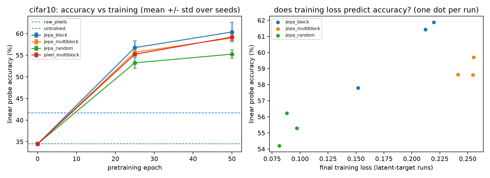

# What does JEPA training add at small scale?

Untrained-encoder controls and masking ablations for a small I-JEPA-style model on CIFAR-10.

**Question.** When a small vision transformer is trained with a JEPA objective (predict the latent representation of hidden image patches), how much of its downstream accuracy comes from the training, how much from the untrained architecture, and does the masking recipe matter?

This repository contains the code and the raw results behind the paper. Everything is small enough to reproduce on one consumer GPU in roughly an hour.

## Main results

CIFAR-10, 50 pre-training epochs, 3 seeds (0, 1, 2). Accuracy in %, mean ± 95% CI over seeds. Features are frozen, average-pooled encoder outputs.

| Condition | Linear probe (100% labels) | Linear (10%) | Linear (1%) | kNN | Effective rank* |
|---|---|---|---|---|---|
| `untrained` (random init, control) | 34.49 ± 1.08 | 33.53 ± 1.44 | 27.96 ± 0.88 | 28.59 ± 0.43 | 11.6 |
| `raw_pixels` (no network) | 41.64 ± 0.17 | 37.27 ± 0.39 | 28.04 ± 1.93 | 45.21 ± 0.00 | not comparable |
| `jepa_multiblock` (I-JEPA masking) | 58.98 ± 1.53 | 56.16 ± 0.75 | 46.36 ± 5.48 | 56.00 ± 1.27 | 68.6 |
| `jepa_block` (single target block) | 60.36 ± 5.56 | 57.25 ± 5.94 | 45.88 ± 6.65 | 56.16 ± 5.19 | 85.9 |
| `jepa_random` (random patches) | 55.24 ± 2.52 | 51.71 ± 3.87 | 40.48 ± 2.86 | 51.21 ± 1.38 | 91.8 |
| `pixel_multiblock` (pixel targets) | 59.20 ± 1.83 | 56.69 ± 1.65 | 47.27 ± 1.98 | 52.24 ± 1.99 | 52.1 |

\*Effective rank of mean-centred features; a value near 1 would indicate representation collapse. The raw-pixel feature space has a different dimension, so its value is not comparable.



Paired differences (same seed, percentage points, linear probe with 100% labels; full table in `results/paired_differences.csv`):

| Comparison | Difference | 95% CI |
|---|---|---|
| `jepa_multiblock` − `untrained` | +24.5 | ± 1.1 |
| `jepa_block` − `untrained` | +25.9 | ± 4.5 |
| `jepa_random` − `untrained` | +20.8 | ± 3.4 |
| `jepa_multiblock` − `pixel_multiblock` | −0.2 | ± 2.4 |
| `jepa_multiblock` − `jepa_random` | +3.7 | ± 2.9 |
| `jepa_multiblock` − `jepa_block` | −1.4 | ± 4.8 |

**What these show**

1. Training adds a large, consistent gain over the untrained encoder (about 21 to 26 points). The untrained encoder is itself weaker than raw pixels, which is part of why the gap is large.
2. Predicting latent targets did not clearly beat predicting pixels on the linear probe. JEPA was ahead on kNN (+3.8 ± 3.0), but that is one of 24 comparisons and should be treated cautiously.
3. Multi-block masking beat random patches on all three metrics (+3.7 to +4.8 points); single block versus multi-block was not distinguishable.
4. No run collapsed. Effective rank did not predict accuracy, and training loss is not comparable across masking schemes.

## Limitations

* Short training: accuracy was still rising at epoch 50, so rankings could change with longer training.
* Three seeds and a single dataset (CIFAR-10); confidence intervals are wide for some comparisons (notably `jepa_block`).
* 24 paired comparisons are reported without correction; isolated "CI excludes 0" results are weak evidence.
* The masking schemes differ in context size as well as geometry: on the 8×8 patch grid the multi-block context averages about 11 tokens (about 18% of 64) after truncation, versus 48 tokens for `jepa_block` and `jepa_random`.
* Absolute accuracies are well below what longer training would give and should not be compared with published numbers that use other protocols.

## Reproduce

```bash
pip install -r requirements.txt
python jepa_small.py selftest                     # seconds; checks masks, shapes, metrics
python jepa_small.py sweep --mode smoke --out_dir runs_smoke   # minutes; end-to-end check on real CIFAR-10
python jepa_small.py sweep --mode fast --epochs 50 --eval_epochs 25,50 --jobs 2 --out_dir runs
python jepa_small.py aggregate --out_dir runs     # tables and figures (also runs at the end of a sweep)
```

CIFAR-10 is downloaded automatically by torchvision. Runs are resumable: re-running the same command skips finished runs and continues interrupted ones.

**Reported results were produced with:** one NVIDIA RTX 3090 (24 GB), Python 3.12, PyTorch 2.14.0 (CUDA 13.0), pandas 3.0.6, SciPy 1.18.1, Matplotlib 3.11.2. One run takes about 11.5 s per epoch on its own; the full sweep (18 runs, two at a time) took roughly 75 minutes.

Another dataset can be selected with `--dataset cifar100`; it was not used for the reported results.

## Repository layout

```
jepa_small.py        all code: model, masking, training, evaluation, sweep, aggregation, self-test
requirements.txt     Python dependencies
results/             snapshot of the reported results
  results_table.md/.csv          table above (mean ± 95% CI)
  paired_differences.csv         paired comparisons with confidence intervals
  all_runs.csv                   every individual run
  fig_cifar10_curves_and_loss.*  figure above
  cifar10_<condition>_s<seed>/   per-run results.json and log.txt
paper/               LaTeX source of the paper, figures and table-generation scripts
```

## Conditions and metrics

* **`untrained`**: the same encoder architecture and seed, with no training. Every trained run starts from identical weights to the `untrained` run of the same seed, so "what training adds" is a paired comparison.
* **`raw_pixels`**: linear probe and kNN directly on pixel values.
* **`jepa_multiblock`, `jepa_block`, `jepa_random`**: JEPA training with different masking schemes.
* **`pixel_multiblock`**: same masks and predictor as `jepa_multiblock`, but the targets are pixels instead of latent features.
* **Linear probe**: classifier trained on frozen average-pooled features with 100%, 10% or 1% of the labels; L2 strength chosen on a held-out validation split; test set scored once.
* **kNN**: cosine kNN (k = 20, temperature 0.07).
* **Collapse diagnostics**: effective rank of mean-centred features (primary), plus an uncentred rank and a feature-spread measure.

## How this relates to I-JEPA

Following I-JEPA: the target encoder sees the full image and is an exponential moving average of the context encoder (momentum 0.996 to 1.0); the context encoder sees only context tokens; a narrow predictor with positional mask tokens predicts the layer-normalised target features; fixed 2D sin-cos position embeddings; multi-block masking (4 target blocks, scale 0.15 to 0.2, one context block, scale 0.85 to 1.0, overlap removed).

Different from the original: a much smaller ViT (patch 4, width 192, depth 6), AdamW with warm-up and cosine decay, batch size 256, crop-and-flip augmentation instead of random-resized-crop, gradient clipping at 1.0, and 50 epochs on 32×32 images. This is a small-scale study of the recipe, not a reproduction of the original results.
